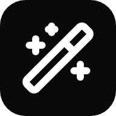
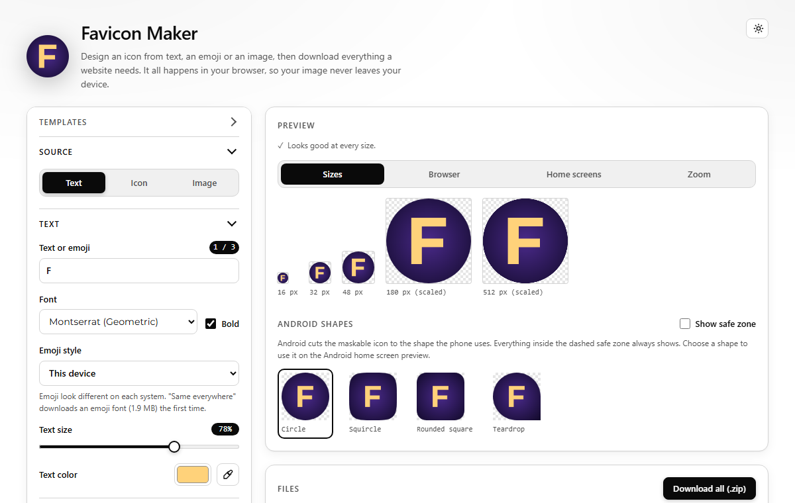
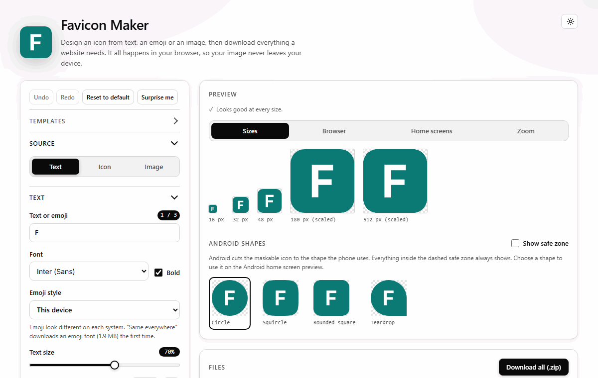

<p align="center">
  
</p>

<h1 align="center">Favicon Maker</h1>

<p align="center">Make every favicon your site needs from text, an emoji, an icon or your own image, right in your browser.</p>

<p align="center">
  <a href="https://xitas.github.io/favicon-maker/"><strong>Try it live</strong></a>
</p>

<p align="center">
  <a href="https://github.com/xitas/favicon-maker/actions/workflows/test.yml"></a>
  <a href="LICENSE"></a>
</p>

<picture>
  <source media="(prefers-color-scheme: dark)" srcset="docs/screenshot-dark.png">
  
</picture>

<p align="center">
  
</p>

Plain HTML, CSS and JavaScript: no frameworks, no build step, nothing to install. Your images and designs never leave your device.

## Contents

- [Features](#features)
- [Generated files](#generated-files)
- [Keyboard shortcuts](#keyboard-shortcuts)
- [Privacy](#privacy)
- [Browser support](#browser-support)
- [Install and offline use](#install-and-offline-use)
- [Development](#development)
- [Fonts and icons](#fonts-and-icons)
- [Project structure](#project-structure)
- [Contributing](#contributing)
- [License](#license)

## Features

**Sources**
- **Text:** up to 3 letters, numbers or emoji, in 8 bundled fonts, so an icon looks the same on every computer
- **Emoji:** your device's emoji, or the same emoji everywhere with a bundled emoji font
- **Icons:** about 2,100 icons from the Lucide library, with search
- **Images:** PNG, JPG, SVG or WebP, uploaded, pasted with Ctrl+V (⌘V on a Mac) or the Paste image button, or dropped anywhere on the page. Pasted SVG code works too. A link alone is never downloaded: save the image first

**Design**
- **Templates:** 16 ready-made styles, shown with your own text; or **Surprise me** for random colors, shape and font that always read well
- **Shape and background:** rounded square, circle, squircle or square; a solid color, a linear or radial gradient, or none; an optional border; position fine-tuning
- **Images:** drag, zoom (slider, mouse wheel, pinch or keyboard) and trim empty edges so the logo fills the square; background colors suggested from the image; an eyedropper next to every color picker
- **Dark mode:** optional different colors in dark mode, which `favicon.svg` switches to by itself
- **Undo and redo** for every change, including templates and Surprise me

**Previews and checks**
- The icon at 16, 32, 48, 180 and 512 px, at real size
- Android's circle, squircle, rounded square and teardrop shapes, with an optional safe zone
- Light and dark browser tabs, a bookmarks bar and a search result; iPhone and Android home screens on three wallpapers
- **Zoom:** the 16 and 32 px files 8 times larger, pixel for pixel, with an optional grid
- **Design checks:** advice on low contrast (with a Fix contrast button), icons that vanish on light or dark tabs, text too small at 16 px and lines too thin at 16 px. They never block a download

**Outputs**
- Every file a website needs, one at a time or all in `favicons.zip` (see [Generated files](#generated-files))
- Ready-to-paste HTML for the `<head>` of your site, with paths for the folder your files go in

**Saved designs and sharing**
- **Autosave:** your design comes back when you open the page again
- **My designs:** save, rename, duplicate, delete, and export or import as `.json` files
- **Share links:** the whole design in a link, with a small image included

**Offline and install**
- Install it as an app, open images and design files with it, and use it without a connection
- A light and dark theme for the page: System (the default), Light or Dark

## Generated files

| File | What it's for |
|---|---|
| `favicon.ico` | Older browsers and anything that asks for `/favicon.ico`. Holds 16, 32 and 48 px |
| `favicon.svg` | Modern browsers: sharp at every size, and can switch colors in dark mode. Made when the design can be a true vector (not for emoji, characters outside the chosen font, or PNG, JPG and WebP uploads) |
| `favicon-16x16.png` | Browser tabs |
| `favicon-32x32.png` | Browser tabs on high-density screens |
| `apple-touch-icon.png` | iPhone and iPad home screens (180 × 180, square, no transparency; iOS rounds the corners) |
| `android-chrome-192x192.png` | Android home screens |
| `android-chrome-512x512.png` | Android splash screens and installs |
| `maskable-icon-192x192.png` | Android icons that fill whatever shape the phone uses (design inside the safe zone) |
| `maskable-icon-512x512.png` | The same, larger |
| `site.webmanifest` | Points Android and installed web apps to the icons, with your app name and colors |

**To use them:**

1. In **Where will the files go?**, enter the folder on your site that will hold the files: `/` for the root, or `/your-repo-name/` for a GitHub Pages project site.
2. Click **Download all (.zip)** and unzip it into that folder.
3. Click **Copy** and paste the HTML into the `<head>` of every page. For the site root it looks like this:

```html
<link rel="icon" href="/favicon.ico" sizes="32x32">
<link rel="icon" href="/favicon.svg" type="image/svg+xml" sizes="any">
<link rel="icon" type="image/png" sizes="32x32" href="/favicon-32x32.png">
<link rel="icon" type="image/png" sizes="16x16" href="/favicon-16x16.png">
<link rel="apple-touch-icon" href="/apple-touch-icon.png">
<link rel="manifest" href="/site.webmanifest">
```

<details>
<summary>How the files are made</summary>

- Each size is drawn on its own canvas, so 16 px icons are drawn at 16 px instead of being shrunk from a large image.
- Letters are drawn from the bundled fonts' own glyph outlines, not by the browser's text engine, so they come out the same in every browser and on every system. `favicon.svg` uses the same outlines, at the same places.
- A large uploaded image is shrunk in halving steps, in premultiplied alpha, so detail stays crisp and transparent edges get no dark fringe.
- The shape, background and border come from the same outline in every file; `favicon.svg` has real SVG gradients.
- An uploaded SVG is used as it is, after anything that could run code or load other files has been removed.
- In the HTML, the ICO is marked `32x32` and the SVG `sizes="any"`, so Chrome, Edge and Firefox use the SVG; other browsers skip it by its `type`.
- The ICO and the ZIP are built in the browser, with no library.

</details>

## Keyboard shortcuts

| Keys | Where | What it does |
|---|---|---|
| Ctrl+Z (⌘Z) | Anywhere outside a text field | Undo |
| Ctrl+Shift+Z or Ctrl+Y (⌘⇧Z) | Anywhere outside a text field | Redo |
| Ctrl+V (⌘V) | Anywhere outside a text field | Paste an image or SVG code |
| ← → ↑ ↓ | Crop view | Move the image by 1% (with Shift, 10%) |
| + and − | Crop view | Zoom in and out |
| 0 | Crop view | Reset the crop |
| ← → ↑ ↓, Home, End | Icon grid | Move through the icons |
| Enter or Space | Icon grid | Choose the icon |
| ← →, Home, End | Preview tabs, Android shapes, wallpapers | Move to the next or previous choice |
| ↑ ↓, Home, End | Theme menu | Move through System, Light and Dark (S, L or D jumps there) |
| Enter | Design name | Save the design |
| Esc | Dialogs, the theme menu, picking a color | Close or cancel |

In a text field, Ctrl+Z and Ctrl+Y undo and redo your typing, as usual.

## Privacy

- **Everything runs in your browser.** There is no server: the page is static files, and it makes no requests to other sites.
- **Your images never leave your device.** Uploaded images are read, drawn and turned into files on your computer.
- **Saved designs stay in your browser:** settings in `localStorage`, images in IndexedDB. **Forget all saved data** removes them. The offline copy (service worker) never holds your images or designs.
- **Share links contain the design itself,** after the `#`, so it never reaches a server: the settings, compressed and checked with a checksum, and an uploaded image only when the link stays under 8,000 characters. Anyone with the link can see the design. Links and imported files are treated as untrusted: every setting is checked, SVG images are cleaned every time, and nothing from them is put into the page as HTML.

## Browser support

Current versions of Chrome, Edge, Firefox and Safari, on desktop and mobile.

- **Safari:** the **Same everywhere** emoji style needs the COLRv1 color font format, which Safari doesn't draw on a canvas, so it uses the system emoji and says so. Safari also shows the ICO or PNG favicon in tabs rather than `favicon.svg`. To install, use **Share → Add to Home Screen**.
- **Eyedropper:** Chrome and Edge use the browser's own eyedropper, which picks a color from anywhere on the screen. Firefox and Safari pick by clicking a pixel in the crop view or the 512 px preview.
- **Paste image button:** reading the clipboard needs the browser's permission and isn't available everywhere; Ctrl+V (⌘V) works in every browser.
- **Installing and opening files:** Chrome and Edge offer **Install app**; opening images and design files with the installed app works in Chrome and Edge on a computer.
- **Offline use** needs https or `localhost`. Opened straight from disk (`file://`), everything else works.

## Install and offline use

Favicon Maker can be installed as an app, and works offline after your first visit.

- **Install:** in Chrome or Edge, on a computer or on Android, click **Install app** above the controls (it shows only when the browser can install the app, and not once it's installed). On iPhone and iPad, tap **Share**, then **Add to Home Screen**.
- **Open files with it:** once installed in Chrome or Edge on a computer, choose Favicon Maker in your system's **Open with** menu for a PNG, JPG, SVG or WebP image, or a design `.json` file exported from the app. An image is loaded and cleaned like an upload; a design file is checked like an import.
- **Offline:** a service worker keeps the app's own files: the page, its styles and scripts, and the app icon. Each font, its outlines, the emoji font and the icon library are large, so each is kept the first time you use it: after you've used a font once, it works offline. To keep everything at once, open **Offline use** at the end of the controls and click **Make everything available offline** (about 6 MB; it shows its progress and can be cancelled). Offline, choosing a font you haven't used yet says "This font isn't available offline yet." and keeps your design as it was.
- **Your designs stay yours:** the service worker never keeps your images or designs. They stay in your browser's IndexedDB and localStorage. When you save a design to **My designs**, the app asks the browser to keep its storage, so it isn't cleared when the device runs low on space, and says what the browser answered.
- **Updates:** when a new version is published, a message says "A new version is available." Click **Reload** to switch (your design is saved first and comes back), or **Not now** to get it next time. The page never reloads by itself.
- **Remove the app:** in the app window, open its menu (**⋯** in the title bar) and choose **Uninstall**, or go to `chrome://apps` or `edge://apps`. On Android, press and hold the icon and choose **Uninstall**; on iPhone and iPad, press and hold it and choose **Remove App**.
- **Clear the offline copy:** on the site, open the site settings (the icon left of the address) and choose **Delete data** or **Clear site data**, or in DevTools go to **Application → Storage → Clear site data**. This also removes your saved designs, so export the ones you want to keep first.

The service worker only runs over https (GitHub Pages) or on `localhost`. Opened straight from disk, the page works as before, without offline use or installing.

Sharing an image to the app from Android's share sheet isn't supported: it would need the service worker to receive the image and hold it until the page opens, and it never handles your images.

## Development

The app needs nothing installed: open `index.html`, or serve the folder to try offline use and installing on `localhost`:

```bash
git clone https://github.com/xitas/favicon-maker.git
cd favicon-maker
python3 -m http.server 8000      # then open http://localhost:8000
```

The tests use Node.js 22 or newer and a few development-only packages, which the page never loads.

```bash
npm ci                                     # the test tools
npx playwright install chromium firefox    # once, for the browser checks
npm test                                   # unit tests
npm run test:browser                       # the real page in Chromium and Firefox, from file:// and a local server
npm run test:perf                          # the timing check (dragging a slider), alone on a quiet machine
```

**On Windows** these run as they are, in PowerShell or Git Bash. The font checks also run in Chrome and Edge when they're installed.

**On Linux, in Docker,** with Playwright's official image (the same version as the `playwright` package), as GitHub Actions does. Changes to drawing, fonts or rendering should be checked this way too, because Linux font engines differ:

```bash
docker run --rm --ipc=host -v "$PWD:/work" -w /work mcr.microsoft.com/playwright:v1.65.1-noble \
  bash -c "npm test && npm run test:browser && npm run test:perf"
```

**Scripts**

| Command | What it does |
|---|---|
| `npm test` | Unit tests |
| `npm run test:browser` | Browser checks in Chromium and Firefox |
| `npm run test:perf` | The timing check: dragging a slider stays smooth. It runs alone, because other tests running at the same time slow it down |
| `npm run build-sw` | Writes every app file's hash into `sw.js` |
| `npm run app-icon` | Makes the app's own icon with the app (`assets/app-icon/`) |
| `npm run og-image` | Makes `og-image.png`, the picture shown when a link is shared |
| `npm run readme-media` | Makes the README's screenshots and demo GIF (`docs/`) |

> **After changing any of the app's files, run `npm run build-sw`.** It writes their new hashes into `sw.js`, so visitors get the new version instead of old copies. A unit test fails until you do.

Known bugs are recorded as todo tests: they show in the results but don't fail the run. GitHub Actions runs every test on each push and pull request; when the "same everywhere" check fails, its images are uploaded for inspection.

To rebuild the bundled fonts: `python -m pip install fonttools brotli`, then `python tools/build-fonts.py`. To rebuild the icon set: `node tools/build-icons.js`.

## Fonts and icons

The icon fonts are bundled in `assets/fonts/`, trimmed to Latin and Latin Extended characters and to their kerning, so each character is always one outline and `favicon.svg` matches the PNGs. A font is downloaded only when you choose it, or when you open Templates (30 to 105 KB each, with its outlines at 90 to 390 KB per weight). Each folder has the font's license next to it.

| Style | Font | Designer | License |
|---|---|---|---|
| Sans | [Inter](https://github.com/rsms/inter) | Rasmus Andersson | SIL Open Font License 1.1 |
| Rounded | [Nunito](https://github.com/googlefonts/nunito) | Vernon Adams, Cyreal, Jacques Le Bailly | SIL Open Font License 1.1 |
| Serif | [Source Serif 4](https://github.com/adobe-fonts/source-serif) | Frank Grießhammer (Adobe) | SIL Open Font License 1.1 |
| Slab | [Zilla Slab](https://github.com/mozilla/zilla-slab) | Typotheque, for Mozilla | SIL Open Font License 1.1 |
| Mono | [JetBrains Mono](https://github.com/JetBrains/JetBrainsMono) | JetBrains, Philipp Nurullin, Konstantin Bulenkov | SIL Open Font License 1.1 |
| Display | [Anton](https://github.com/googlefonts/AntonFont) | Vernon Adams | SIL Open Font License 1.1 |
| Geometric | [Montserrat](https://github.com/JulietaUla/Montserrat) | Julieta Ulanovsky, Sol Matas, Juan Pablo del Peral, Jacques Le Bailly | SIL Open Font License 1.1 |
| Handwritten | [Caveat](https://github.com/googlefonts/caveat) | Impallari Type | SIL Open Font License 1.1 |
| Emoji | [Noto Color Emoji](https://github.com/googlefonts/noto-emoji) | Google | SIL Open Font License 1.1 |

Characters a font doesn't have, such as Urdu, Arabic, Chinese or Hindi, are drawn with your system's font, and the page tells you they may look different on other computers. The emoji font (1.9 MB) is downloaded only when you choose **Same everywhere**.

The Icon source uses [Lucide](https://lucide.dev) 1.77.0 (ISC license, see `assets/icons/LICENSE`), by Lucide Icons and Contributors. Its 2,098 icons are bundled as path data in `assets/icons/lucide.js` (about 150 KB when a server compresses it), downloaded only when you choose the Icon source. Saved designs and share links keep only the icon's name.

## Project structure

```
.
├── index.html            # The page
├── manifest.webmanifest  # Web app manifest: name, icons, opening image and design files
├── sw.js                 # Service worker: keeps the app's own files for offline use
├── og-image.png          # The picture shown when a link is shared (tools/make-og-image.js)
├── robots.txt, sitemap.xml
├── assets/
│   ├── app-icon/         # The app's own favicon, made by the app (tools/make-app-icon.js)
│   ├── fonts/            # Bundled icon fonts (woff2) and their glyph outlines, each with its license
│   └── icons/            # The Lucide icon set as path data, with its license
├── css/style.css         # All styles
├── js/
│   ├── lib/              # zip.js, ico.js, shrink.js, svg.js: file builders, image shrinking, SVG
│   ├── imagetools.js     # Pastes and drops, crop math, trimming edges, colors from an image
│   ├── fonts.js          # Bundled font list, character coverage and font loading
│   ├── icons.js          # The icon set: loading, lookup and search
│   ├── draw.js           # Draws the icon on a canvas from the settings
│   ├── outputs.js        # Generated files, manifest, HTML snippet
│   ├── design.js         # Settings, format versions, undo history, share links, export files
│   ├── store.js          # Saving in the browser (localStorage and IndexedDB)
│   ├── checks.js         # Design checks
│   ├── templates.js      # Templates and Surprise me
│   ├── theme.js          # The page's theme: System, Light or Dark
│   ├── dialog.js         # Confirm and prompt dialogs
│   ├── previews.js       # Preview tabs and mockups
│   └── app.js            # The page's controls, previews, downloads, saving and sharing
├── docs/                 # README screenshots and demo (tools/make-readme-media.js)
├── tests/                # Unit tests (tests/unit) and Playwright checks (tests/browser)
└── tools/                # Maintainer scripts: fonts, icons, service worker, app icon, pictures
```

The scripts are plain (non-module) scripts loaded in order, so the page works when `index.html` is opened straight from disk. Each exposes one object that the files after it use.

## Contributing

Issues and pull requests are welcome. Before opening a pull request:

- Keep to plain HTML, CSS and JavaScript, with no frameworks, build step or runtime dependencies, and no requests to other sites.
- Keep the interface monochrome; the only color comes from the icons.
- Check light and dark themes, a 390 px wide phone, the keyboard alone, a screen reader and reduced motion.
- Run `npm test` and `npm run test:browser` (and the Docker command above for drawing or font changes), and `npm run build-sw` if you changed app files.

Contributions are accepted under the project's license.

## License

Free for personal and other non-commercial use under the [PolyForm Noncommercial License 1.0.0](LICENSE). For commercial use, please [open an issue](https://github.com/xitas/favicon-maker/issues).

The bundled fonts are under the SIL Open Font License 1.1 and the Lucide icons under the ISC license; see [Fonts and icons](#fonts-and-icons).
